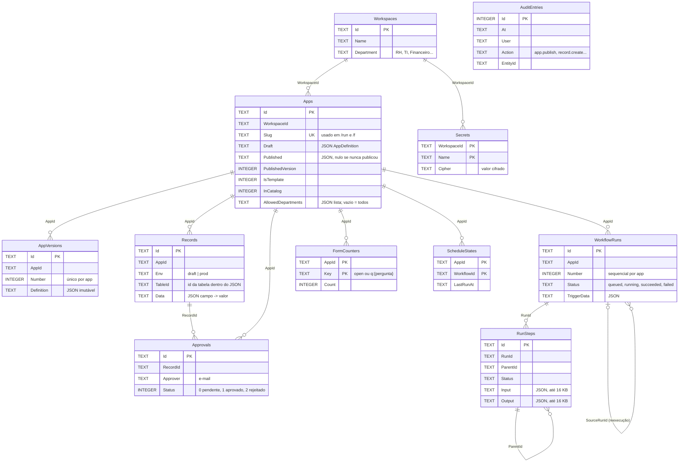
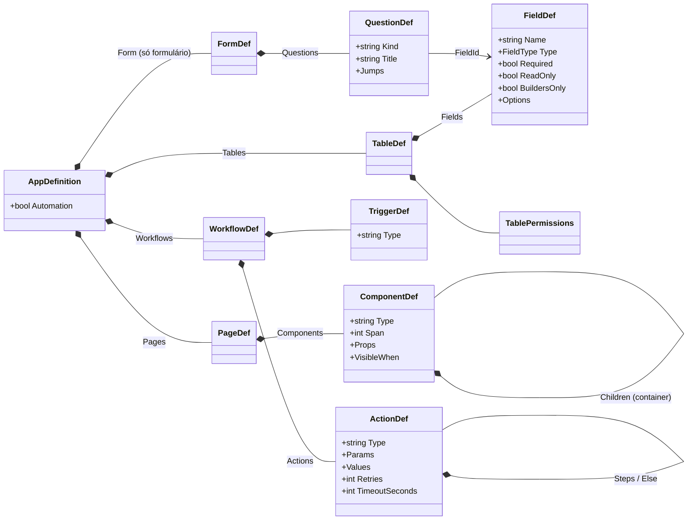
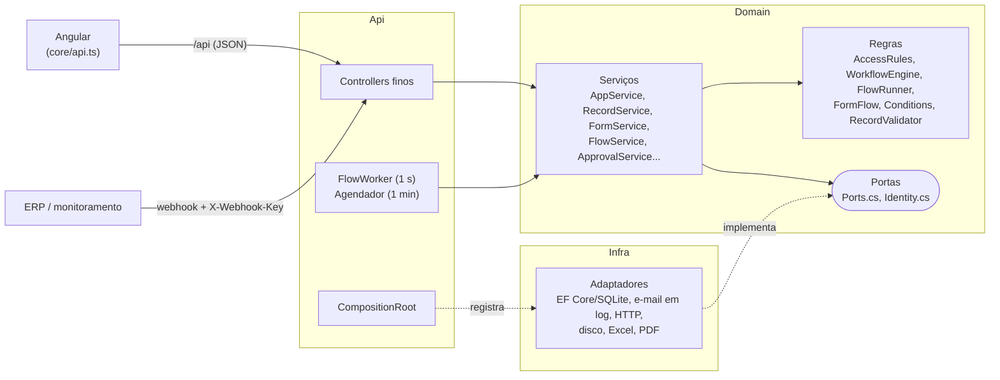

# Referência técnica

Documentação básica do banco, do backend e das rotas. O porquê das decisões está em [ARQUITETURA.md](ARQUITETURA.md) e
nos [ADRs](ADR/README.md); aqui fica o "o que é e onde está".

## 1. Banco de dados

SQLite em `api/src/Api/data/app.db`, criado por EF Core com `EnsureCreated` (sem migrations) e populado pelo seed na
primeira subida. São 11 tabelas.

Duas escolhas explicam quase tudo:

- **O app é um documento.** Páginas, tabelas, campos, automações e perguntas de formulário ficam num JSON
  (`AppDefinition`) nas colunas `Apps.Draft`, `Apps.Published` e `AppVersions.Definition`. Criar uma tabela no editor
  **não** cria tabela no banco.
- **Os registros dos apps também são JSON.** Todos os dados digitados pelos usuários, de todos os apps, ficam numa
  tabela só (`Records`), com os valores em `Data`. Busca, filtro e agregação usam `json_extract` do SQLite.

### Diagrama

As linhas são relações lógicas: o banco **não tem chave estrangeira**. A integridade (apagar registros de um app
excluído, por exemplo) é feita pelo código do Domain.



### O que cada tabela guarda

| Tabela | Guarda | Cresce com |
|---|---|---|
| `Workspaces` | Um espaço por área (departamento) | Áreas (dezenas) |
| `Apps` | Mini apps, formulários, workflows e templates, com rascunho e versão publicada | Projetos (centenas) |
| `AppVersions` | Cópia imutável de cada publicação, para restaurar | Publicações |
| `Records` | Dados de todos os apps, separados por app, ambiente e tabela | Uso (a maior tabela) |
| `Approvals` | Pedidos de aprovação e decisão | Aprovações |
| `AuditEntries` | Quem fez o quê e quando | Toda ação (a segunda maior) |
| `WorkflowRuns` / `RunSteps` | Fila e histórico das execuções de workflow (apagados depois de 30 dias) | Execuções × passos |
| `Secrets` | Segredos do workspace (chaves de API), cifrados com `data/secrets.key` | Poucos |
| `FormCounters` | Aberturas do formulário e alcance de cada pergunta | Fixo por formulário |
| `ScheduleStates` | Última execução de cada automação agendada | Fixo por automação |

Tipos: Ids são GUID em texto (exceto `AuditEntries.Id`), datas em texto ISO (UTC) e booleanos em `INTEGER`. Dentro de
`Records.Data`, número vai com ponto (`1840.9`), data como `yyyy-MM-dd`, seleção como o texto da opção, relação como o
Id do registro e arquivo como o Id do upload. Os arquivos ficam em disco, em `data/uploads/` (porta `IFileStorage`).

### DDL

Gerado pelo EF Core (é o que está no banco):

```sql
CREATE TABLE "Workspaces" (
    "Id" TEXT NOT NULL CONSTRAINT "PK_Workspaces" PRIMARY KEY,
    "Name" TEXT NOT NULL,
    "Department" TEXT NOT NULL
);
CREATE TABLE "Apps" (
    "Id" TEXT NOT NULL CONSTRAINT "PK_Apps" PRIMARY KEY,
    "WorkspaceId" TEXT NOT NULL,
    "Name" TEXT NOT NULL,
    "Slug" TEXT NOT NULL,
    "Description" TEXT NOT NULL,
    "Draft" TEXT NOT NULL,
    "Published" TEXT NULL,
    "PublishedVersion" INTEGER NULL,
    "IsTemplate" INTEGER NOT NULL,
    "InCatalog" INTEGER NOT NULL,
    "AllowedDepartments" TEXT NOT NULL,
    "CreatedBy" TEXT NOT NULL,
    "CreatedAt" TEXT NOT NULL,
    "UpdatedAt" TEXT NOT NULL
);
CREATE TABLE "AppVersions" (
    "Id" TEXT NOT NULL CONSTRAINT "PK_AppVersions" PRIMARY KEY,
    "AppId" TEXT NOT NULL,
    "Number" INTEGER NOT NULL,
    "Definition" TEXT NOT NULL,
    "PublishedBy" TEXT NOT NULL,
    "PublishedAt" TEXT NOT NULL
);
CREATE TABLE "Records" (
    "Id" TEXT NOT NULL CONSTRAINT "PK_Records" PRIMARY KEY,
    "AppId" TEXT NOT NULL,
    "Env" TEXT NOT NULL,
    "TableId" TEXT NOT NULL,
    "Data" TEXT NOT NULL,
    "CreatedBy" TEXT NOT NULL,
    "CreatedAt" TEXT NOT NULL,
    "UpdatedBy" TEXT NULL,
    "UpdatedAt" TEXT NULL
);
CREATE TABLE "Approvals" (
    "Id" TEXT NOT NULL CONSTRAINT "PK_Approvals" PRIMARY KEY,
    "AppId" TEXT NOT NULL,
    "Env" TEXT NOT NULL,
    "TableId" TEXT NOT NULL,
    "RecordId" TEXT NOT NULL,
    "Title" TEXT NOT NULL,
    "StatusField" TEXT NOT NULL,
    "Approver" TEXT NOT NULL,
    "RequestedBy" TEXT NOT NULL,
    "Status" INTEGER NOT NULL,
    "Comment" TEXT NULL,
    "CreatedAt" TEXT NOT NULL,
    "DecidedAt" TEXT NULL
);
CREATE TABLE "AuditEntries" (
    "Id" INTEGER NOT NULL CONSTRAINT "PK_AuditEntries" PRIMARY KEY AUTOINCREMENT,
    "At" TEXT NOT NULL,
    "User" TEXT NOT NULL,
    "Action" TEXT NOT NULL,
    "Entity" TEXT NOT NULL,
    "EntityId" TEXT NULL,
    "Details" TEXT NULL
);
CREATE TABLE "WorkflowRuns" (
    "Id" TEXT NOT NULL CONSTRAINT "PK_WorkflowRuns" PRIMARY KEY,
    "AppId" TEXT NOT NULL,
    "Env" TEXT NOT NULL,
    "WorkflowId" TEXT NOT NULL,
    "Number" INTEGER NOT NULL,
    "Version" INTEGER NULL,
    "Status" TEXT NOT NULL,
    "Trigger" TEXT NOT NULL,
    "TriggerData" TEXT NOT NULL,
    "RequestedBy" TEXT NOT NULL,
    "CreatedAt" TEXT NOT NULL,
    "StartedAt" TEXT NULL,
    "FinishedAt" TEXT NULL,
    "Error" TEXT NULL,
    "StartFromStepId" TEXT NULL,
    "SourceRunId" TEXT NULL
);
CREATE TABLE "RunSteps" (
    "Id" TEXT NOT NULL CONSTRAINT "PK_RunSteps" PRIMARY KEY,
    "RunId" TEXT NOT NULL,
    "ParentId" TEXT NULL,
    "Order" INTEGER NOT NULL,
    "Depth" INTEGER NOT NULL,
    "StepId" TEXT NULL,
    "Name" TEXT NOT NULL,
    "Type" TEXT NOT NULL,
    "Status" TEXT NOT NULL,
    "StartedAt" TEXT NOT NULL,
    "FinishedAt" TEXT NULL,
    "Input" TEXT NULL,
    "Output" TEXT NULL,
    "Error" TEXT NULL
);
CREATE TABLE "Secrets" (
    "WorkspaceId" TEXT NOT NULL,
    "Name" TEXT NOT NULL,
    "Cipher" TEXT NOT NULL,
    "UpdatedBy" TEXT NOT NULL,
    "UpdatedAt" TEXT NOT NULL,
    CONSTRAINT "PK_Secrets" PRIMARY KEY ("WorkspaceId", "Name")
);
CREATE TABLE "FormCounters" (
    "AppId" TEXT NOT NULL,
    "Key" TEXT NOT NULL,
    "Count" INTEGER NOT NULL,
    CONSTRAINT "PK_FormCounters" PRIMARY KEY ("AppId", "Key")
);
CREATE TABLE "ScheduleStates" (
    "AppId" TEXT NOT NULL,
    "WorkflowId" TEXT NOT NULL,
    "LastRunAt" TEXT NOT NULL,
    CONSTRAINT "PK_ScheduleStates" PRIMARY KEY ("AppId", "WorkflowId")
);

CREATE UNIQUE INDEX "IX_Apps_Slug" ON "Apps" ("Slug");
CREATE UNIQUE INDEX "IX_AppVersions_AppId_Number" ON "AppVersions" ("AppId", "Number");
CREATE INDEX "IX_Records_AppId_Env_TableId" ON "Records" ("AppId", "Env", "TableId");
CREATE INDEX "IX_Approvals_Approver" ON "Approvals" ("Approver");
CREATE INDEX "IX_AuditEntries_At" ON "AuditEntries" ("At");
CREATE INDEX "IX_WorkflowRuns_AppId_Env" ON "WorkflowRuns" ("AppId", "Env");
CREATE INDEX "IX_WorkflowRuns_Status" ON "WorkflowRuns" ("Status");
CREATE INDEX "IX_RunSteps_RunId" ON "RunSteps" ("RunId");
```

### Dentro do JSON do app (`AppDefinition`)



Gatilhos (`TriggerDef.Type`): `click`, `recordCreated`, `recordUpdated`, `schedule` (mini app e formulário) e `manual`, `webhook`, `schedule`, `call` (workflow).

O tipo do projeto vem do JSON, sem coluna: tem `Form` → formulário; `Automation = true` → workflow; senão, mini app.
`Records.TableId` aponta para `TableDef.Id` e `Records.Data` usa `FieldDef.Name` como chave (renomear um campo migra os
dados ao salvar e ao publicar).

## 2. Backend em resumo

.NET 10, três projetos e uma regra: `Api → Domain ← Infra`. O Domain não referencia nenhum pacote.



- **Controllers** só traduzem HTTP para chamadas de serviço (`Controllers.cs`, um arquivo). Não checam acesso.
- **Serviços do Domain** checam acesso sempre (`AccessRules`): se o usuário gerencia o workspace, se o departamento
  dele pode usar o app, se a tabela deixa criar, editar ou excluir, quais campos ele vê.
- **Erros** viram respostas HTTP no `DomainExceptionHandler`: validação → 400, sem login → 401, sem permissão → 403,
  não encontrado → 404. O corpo é um `ProblemDetails` com a mensagem em português.
- **Portas e adaptadores**: banco (`IAppRepository`, `IRecordRepository`, `IRunStore`...), usuário (`IUserProvider`,
  hoje o mock de `mock-auth.json`), e-mail (`IEmailSender`, hoje só log), HTTP de saída (`IHttpConnector`, tempo limite
  de 15 s), arquivos (`IFileStorage`, disco), Excel e PDF (gerados sem dependência). Todos registrados só no
  `CompositionRoot`; a troca para o ambiente corporativo está em [TROCA-DE-ADAPTADORES.md](TROCA-DE-ADAPTADORES.md).
- **Trabalho em segundo plano**, no mesmo processo da API:
  - `FlowWorkerHostedService`: a cada 1 s pega a próxima execução `queued` da fila e roda, uma por vez.
  - `ScheduledWorkflowsHostedService`: a cada 1 min vê quais automações agendadas venceram e enfileira.
  - Por isso a API roda em **uma instância**. Para mais de uma, a fila e o agendador precisam de trava ou de uma fila real.

## 3. Volume de requisições

Não houve teste de carga. Os números abaixo são o que o código faz e os limites que ele impõe, para estimar.

### O que cada tela pede

| Tela | Requisições ao abrir | Depois |
|---|---|---|
| Qualquer tela | `GET /api/me` (uma vez na sessão) | Contador de aprovações ao navegar |
| Início (`/`) | Builder: 2 (`/api/apps` e `/api/workspaces`); usuário: 1 (catálogo) | Nada |
| App publicado (`/run/:slug`) | 1 para a definição + 1 por tabela/lista + 1 por gráfico + 1 por campo de relação | Busca espera 300 ms sem digitar antes de consultar; cada página da tabela é 1 requisição |
| Formulário (`/f/:slug`) | 1 para abrir + 1 evento por pergunta vista | 1 envio no fim |
| Editor | 1 para o app (+ versões, execuções ou resumo, conforme a aba) | Salva sozinho 2,5 s depois da última edição (1 `PUT`) |
| Execuções do workflow | 1 lista | Repete a cada 1,5 s **só enquanto há execução na fila ou rodando** |

### Limites no servidor

| Limite | Valor | Onde |
|---|---|---|
| Itens por página | 20 na tabela, 12 na lista, no máximo 100 pela API | `PAGE_SIZE`, `RecordService` |
| Requisições a formulários | 120 por minuto por pessoa (ou IP sem login) | `Forms:RequestsPerMinute` |
| Envios de formulário | 5 por hora por pessoa ou IP (1000 em desenvolvimento) | `Forms:SubmitsPerHour` |
| Encadeamento de automações | 5 níveis | `WorkflowEngine` |
| Passos por execução de workflow | 500; "para cada" até 1000 itens | `FlowRules` |
| Tempo limite | 30 s por passo (até 600), 15 min por execução, 15 s por chamada HTTP | `FlowRules`, `FlowRunner`, `CompositionRoot` |
| Histórico de execuções | 30 dias, até 16 KB por passo | `FlowRunner` |
| Auditoria na tela | Últimos 200 eventos | `AuditController` |

### Ordem de grandeza

Uma pessoa usando um app publicado gera poucas requisições por minuto: abrir a tela (3 a 6), buscar, salvar. O que
pesa é o SQLite, que aceita **um escritor por vez**: leitura escala bem, mas muitos envios simultâneos entram em fila.
Para uma área com algumas dezenas de usuários isso basta. Para a empresa inteira, a troca prevista é o banco
(SQL Server ou PostgreSQL, trocando o provider do EF em `InfraServiceCollection`) e a fila de workflows, antes de pensar
em mais instâncias da API.

## 4. Rotas do front

Angular 20, rotas em `web/src/app/app.routes.ts`. As rotas de editor e de execução carregam sob demanda (lazy).

> Os guards do front só escondem telas. Quem protege de verdade é o backend: um usuário que digitar a URL de um app
> que não pode ver recebe 403 da API.

| Rota | Tela | Quem acessa | Proteção | O que faz |
|---|---|---|---|---|
| `/` | Início | Todos | Logado | Criar projeto (builder), recentes com miniatura e filtro por tipo, ou os apps liberados (usuário) |
| `/biblioteca` | Biblioteca | Todos | Logado | Templates (builder: "Usar template") e apps publicados liberados para o departamento |
| `/catalog` | (redireciona) | Todos | — | Vai para `/biblioteca` (endereço antigo) |
| `/approvals` | Aprovações | Todos | Logado | Pedidos esperando a sua decisão e histórico do que você pediu ou decidiu |
| `/run/:slug` | App publicado | Departamentos liberados no app | Logado; acesso checado na API | Mini app em tela limpa, versão de produção |
| `/preview/:id` | Prévia do rascunho | Quem gerencia o app | `builderGuard` | O app com os dados de rascunho, dentro da moldura |
| `/f/:slug` | Responder formulário | Departamentos liberados, ou qualquer pessoa se o link for público | Público opcional; limite de requisições | Uma pergunta por vez, versão de produção |
| `/f-preview/:id` | Testar formulário | Quem gerencia | `builderGuard` | O formulário em rascunho; respostas vão para o rascunho |
| `/builder` | Meus apps | Builder e admin | `builderGuard` | Lista dos projetos dos workspaces que você gerencia |
| `/builder/:id` | Editor | Quem gerencia o workspace do projeto | `builderGuard`; acesso checado na API | Abas conforme o tipo (`?aba=` na URL): mini app (Design, Dados, Automações, Publicação), formulário (Perguntas, Respostas, Compartilhar, Automações, Publicação), workflow (Workflow, Execuções, Segredos, Publicação) |
| `/admin` | Governança | Admin | `adminGuard` | Auditoria e criação de workspaces |
| `**` | (redireciona) | — | — | Vai para `/` |

`builderGuard` deixa passar builder e admin; `adminGuard`, só admin. Quem não passa volta para `/`.

## 5. Rotas da API

Todas sob `/api`, em `api/src/Api/Controllers/Controllers.cs`. "Logado" quer dizer que precisa de usuário (hoje vem do
`mock-auth.json`; no corporativo, do SSO). `{env}` é `draft` ou `prod`.

| Método e rota | Quem | Para quê |
|---|---|---|
| `GET /me` | Logado | Usuário atual (nome, papel, departamento) |
| `GET, POST /workspaces` | Logado; criar só admin | Workspaces que você gerencia; criar workspace |
| `GET, PUT, DELETE /workspaces/{id}/secrets` | Quem gerencia o workspace | Nomes dos segredos (o valor nunca volta), gravar, apagar |
| `GET /apps`, `/apps/templates`, `/apps/catalog` | Logado | Seus projetos, templates, apps publicados liberados para você |
| `GET, POST, PUT, DELETE /apps/{id}` | Quem gerencia | Abrir, criar, salvar rascunho, excluir |
| `POST /apps/{id}/publish`, `/rollback/{n}`, `/duplicate`; `GET /apps/{id}/versions` | Quem gerencia (duplicar: quem pode ver) | Publicar, restaurar versão, clonar, histórico |
| `GET /run/{slug}` | Departamentos liberados | App publicado para usar |
| `GET, POST, PUT, DELETE /apps/{id}/{env}/tables/{t}/records` | Conforme permissões da tabela | Listar (busca e página), criar, editar, excluir |
| `GET .../records/summary`, `/labels`, `/export`; `POST .../import` | Quem acessa o app | Gráficos, rótulos de relação, Excel/CSV/PDF, importação |
| `POST /apps/{id}/{env}/workflows/{w}/run` | Quem acessa o app | Botão que dispara automação |
| `POST, GET /apps/{id}/{env}/files` | Quem acessa o app | Enviar e baixar anexos |
| `GET, POST /apps/{id}/{env}/runs`; `GET /runs/{r}`; `POST /runs/{r}/rerun` | Quem gerencia o workflow | Execuções, executar agora, detalhe com passos, reexecutar |
| `GET /apps/{id}/form/draft`, `/stats`; `POST /form/draft/responses` | Quem gerencia | Testar formulário, resumo das respostas |
| `GET /forms/{slug}`; `POST /forms/{slug}/responses`, `/events` | Liberados ou público (link aberto) | Abrir, enviar e contar aberturas; com limite de requisições |
| `GET /approvals`; `POST /approvals/{id}/decide` | Logado; decidir só o aprovador (ou admin) | Caixa de aprovações |
| `GET /audit` | Admin | Últimos eventos da auditoria |
| `POST /hooks/{app}/{tabela}` | Sem usuário: chave em `X-Webhook-Key` | Outro sistema cria registro em produção |
| `POST /hooks/wf/{app}` | Sem usuário: chave em `X-Webhook-Key` | Outro sistema dispara um workflow |
