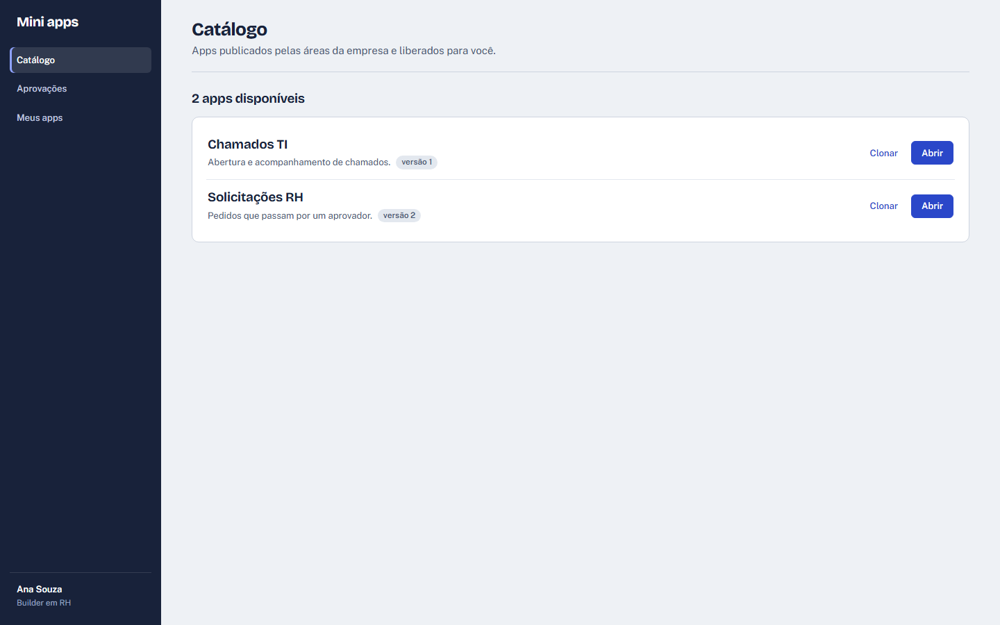

# Mini apps

Sabe aquela planilha de pedidos que circula por e-mail, o formulário que ninguém sabe onde foi parar e o controle de reservas que mora no caderno de alguém? O Mini apps existe para isso. Quem conhece o processo monta o app, publica e o resto da empresa usa. Sem abrir chamado para TI e sem comprar mais uma licença.


## Como funciona

Cada área tem o seu espaço. O RH monta os apps do RH, a TI monta os da TI, e o que for útil para todo mundo vai para o catálogo da empresa. Quem usa um app só vê o app. O editor fica para quem monta.

Um app tem três partes: as telas, os dados e as automações. Você monta as três na mesma tela, testa no rascunho e publica quando estiver pronto.

## Montar as telas

Arraste os componentes para a folha: texto, botão, campo de entrada, card, formulário, tabela, lista, gráfico e container. A folha mostra o app do jeito que ele vai ficar, com os campos da sua tabela no formulário e as colunas certas na tabela.

- Largura em frações (metade, um terço, linha inteira). No celular tudo vira uma coluna, e dá para conferir isso na prévia de celular antes de publicar.
- Containers agrupam componentes e podem ficar um dentro do outro.
- Cada componente pode aparecer só em certas situações: só para quem gerencia o app, só para um departamento, só quando um campo foi preenchido.
- Atalhos para quem monta muita tela: Delete remove, Ctrl+D duplica, Alt+setas mudam a ordem.

## Os dados já vêm junto

Crie tabelas e campos de texto, número, data, lista de opções, relação com outra tabela e anexo. O app ganha na hora formulário, listagem, edição e exclusão, sem configurar banco nenhum.

Um botão gera a página com formulário e tabela a partir de uma tabela pronta. A busca não liga para acento nem maiúscula, e a paginação aguenta tabelas grandes.

Você decide o que o usuário pode fazer em cada tabela (criar, editar, excluir) e em cada campo: campo só leitura aparece mas não pode ser alterado, campo oculto só quem gerencia o app vê.


## Automações

Escolha quando a automação roda, uma condição opcional e o que ela faz. Ela pode rodar:

- quando alguém clica num botão;
- quando um registro é criado ou alterado;
- num horário: a cada hora, todo dia às 8h, toda segunda às 9h30.

E pode criar ou atualizar registros, mandar e-mail, chamar a API de outro sistema, levar o usuário para outra página, pedir uma aprovação ou chamar outra automação. Uma automação pode disparar a próxima: o pedido aprovado avisa compras, que cria a tarefa, que avisa o responsável. Se alguém montar um ciclo sem querer, ele para sozinho no quinto passo e fica registrado.


## Aprovações

O caso mais comum de todos. O pedido entra, vai para o aprovador, ele aprova ou rejeita com um comentário e o status volta para o registro. O solicitante recebe e-mail. O aprovador tem uma caixa só dele com tudo o que está esperando decisão, e cada um vê o histórico do que pediu.


## Publicar e voltar atrás

O rascunho e a versão publicada são separados, inclusive os dados. Dá para testar à vontade sem sujar o app que está em uso. Publicar é um clique e cada publicação vira uma versão numerada. Se a versão nova deu problema, restaure a anterior.

Renomeou um campo? Os dados acompanham o nome novo.

## Dados para fora e para dentro

- Exportar qualquer tabela em Excel, CSV ou PDF. O PDF sai pronto para mandar: gráficos, valores no formato brasileiro, texto longo quebrado em linhas e número de página.
- Importar planilha do Excel ou CSV. As linhas com problema voltam com o motivo, as boas entram.
- Receber dados de outros sistemas por webhook: o ERP manda os pedidos e eles entram no app como se alguém tivesse preenchido o formulário.

## Comece por um modelo

Oito modelos prontos para copiar e adaptar: solicitações com aprovação, checklist, inventário, controle de chamados, onboarding, reservas de sala, CRM simples e cadastros. Qualquer app pode virar modelo para outras áreas, e um app do catálogo pode ser copiado para o seu espaço.



## Para quem administra

- Um espaço por área, criado pela governança.
- Três perfis: administrador, builder (monta apps da própria área) e usuário.
- Cada app escolhe quais departamentos podem usá-lo.
- Registro de tudo: quem criou, editou, publicou, abriu, exportou ou aprovou o quê, e quando.

## No celular

O app publicado funciona no celular sem configuração extra. As telas de administração também.


## O que ainda não faz

Para não ter surpresa:

- Login e e-mail são simulados nesta versão. O usuário vem de um arquivo de configuração e os e-mails aparecem no log do servidor. A troca pelo login e pelo serviço de e-mail da empresa está descrita em [DOCS/TROCA-DE-ADAPTADORES.md](DOCS/TROCA-DE-ADAPTADORES.md).
- Não avisa no Teams nem no Slack.
- Não tem conector pronto para Google Sheets ou SharePoint. Dá para integrar pela chamada de API e pelo webhook.
- Esconder um componente da tela não protege o dado. Para isso existem as permissões de tabela e de campo.

## Para quem vai rodar o projeto

Angular 20 no front, .NET 10 no back, SQLite como banco.

```bash
cd api/src/Api && dotnet run          # API em http://localhost:5072
cd web && npm install && npm start    # app em http://localhost:4200
```

Quem está logado é definido em [mock-auth.json](mock-auth.json): troque o `currentUser` e recarregue a página. Os usuários de exemplo são `admin`, `ana` (builder do RH), `bruno` (builder da TI), `joao` (usuário do RH) e `carla` (usuária do Financeiro), todos `@corp.local`.

Para testar o fluxo de aprovação: entre como `joao@corp.local`, abra "Solicitações RH" no catálogo e crie um pedido com aprovador `ana@corp.local`. Depois troque para `ana@corp.local` e aprove em Aprovações.

Mais detalhes: [PRD](DOCS/PRD.md), [arquitetura](DOCS/ARQUITETURA.md), [dependências](DOCS/DEPENDENCIAS.md), [troca de adaptadores](DOCS/TROCA-DE-ADAPTADORES.md) e [testes](DOCS/TDD.md).
