# Mini apps corporativos

Toda empresa tem uma planilha de pedidos que circula por e-mail, um formulário que ninguém sabe onde foi parar e uma aprovação que depende de alguém lembrar de responder. Este projeto existe para isso: quem conhece o processo monta o app, publica, e o resto da empresa usa. Sem chamado para a TI e sem mais uma licença.

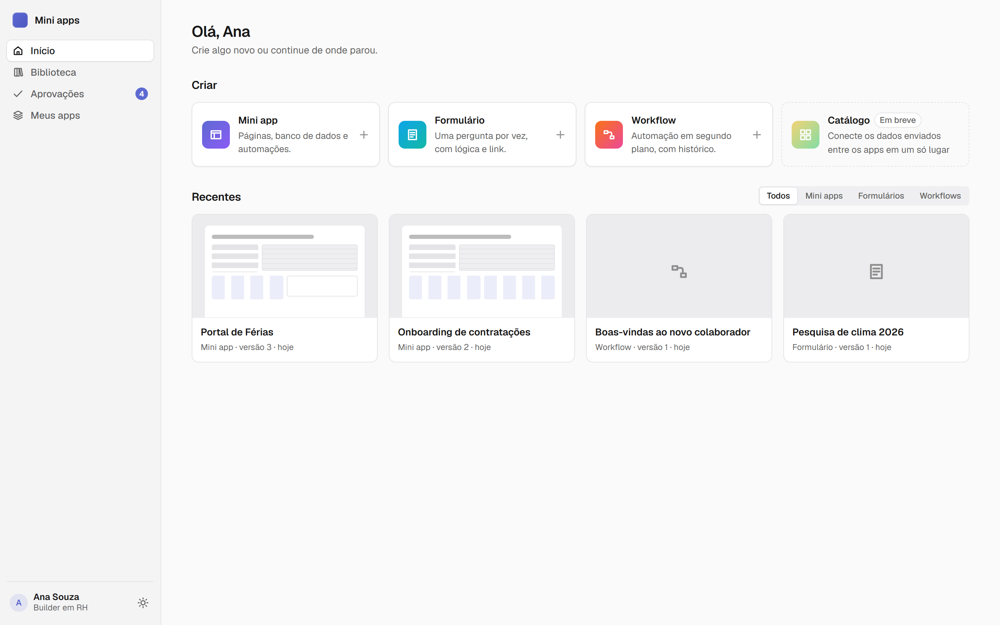

São três tipos de projeto, todos no mesmo lugar:

| | Para quê | Inspirado em |
|---|---|---|
| **Mini app** | Telas com formulário, tabela e gráficos sobre um banco que já vem pronto | Bubble |
| **Formulário** | Uma pergunta por vez, com lógica de pulo e link público | Typeform |
| **Workflow** | Automação em segundo plano, com fila, histórico e reexecução | n8n, trigger.dev |

Os três publicam em versões, respeitam as permissões de cada área e aparecem na auditoria.

## O cenário de demonstração

O banco sobe populado com uma empresa fictícia, para dar para apresentar sem montar nada antes. Cada área tem um mini app, um formulário e um workflow, e eles conversam entre si.

| Área | Mini apps | Formulário | Workflow |
|---|---|---|---|
| **RH** (Ana) | Portal de Férias, Onboarding de contratações | Pesquisa de clima 2026 | Boas-vindas ao novo colaborador |
| **TI** (Bruno) | Central de Chamados, Inventário de equipamentos | Solicitação de acesso a sistemas | Alertas de monitoramento |
| **Financeiro** (Marina) | Reembolso de despesas | Cadastro de fornecedores | Pagamento de reembolso |

Tem pedido esperando aprovação, pesquisa com 34 respostas, chamado aberto, execução que deu certo e uma que falhou de propósito. A Biblioteca traz mais oito templates para começar do zero.

## Mini apps

O editor tem a folha no meio, os componentes à esquerda e as propriedades à direita. Você arrasta texto, botão, campo, card, formulário, tabela, lista, gráfico e container. A folha já mostra o app com os campos da tabela, então o que você vê é o que vai para o ar.

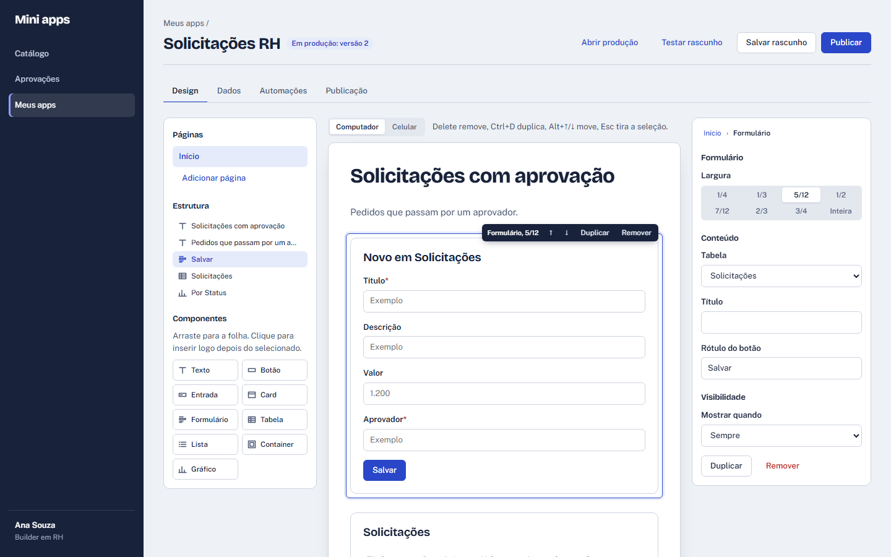

O app publicado é uma tela limpa, sem nada da plataforma em volta. O formulário grava na tabela, a tabela tem busca e paginação, e os gráficos contam no banco. Dá para baixar em Excel, CSV ou PDF e importar planilha.

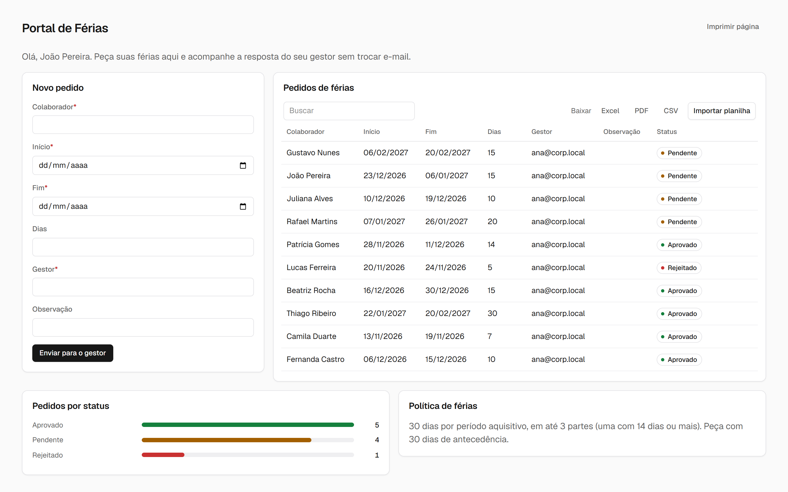

Alguns detalhes que fazem diferença no dia a dia:

- Cada tabela diz se o usuário pode criar, editar ou excluir. Cada campo pode ser só leitura (o status de uma aprovação, por exemplo) ou oculto, visível só para quem gerencia o app. No Inventário, o valor do equipamento só aparece para a TI.
- Um componente pode aparecer só em certas situações: para quem gerencia o app, para um departamento, quando um campo foi preenchido. Na Central de Chamados, o card com a meta do mês só aparece para o time de suporte.
- Textos aceitam variáveis. "Olá, {{user.name}}" vira "Olá, João Pereira" no app.
- O rascunho salva sozinho, e os dados do rascunho são separados dos de produção. Dá para testar à vontade sem sujar o app em uso.

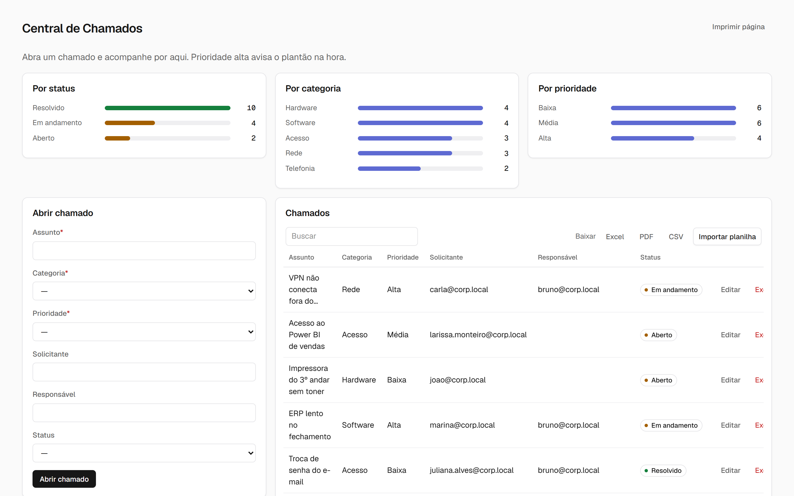

### Automações do mini app

Cada app tem as suas automações: um gatilho (clique, registro criado ou alterado, horário), uma condição opcional e os passos. Os passos criam e atualizam registros, mandam e-mail, chamam a API de outro sistema, pedem aprovação, abrem outro projeto ou iniciam um workflow.

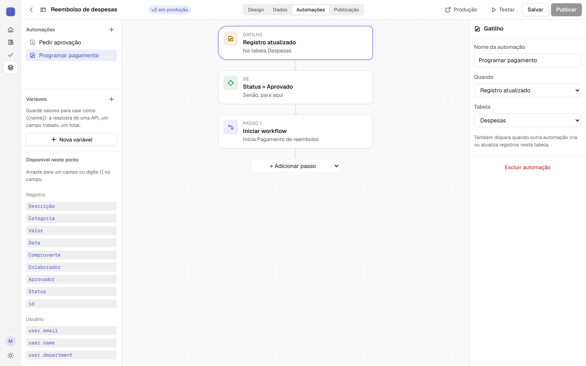

## Formulários

Uma pergunta por tela, como no Typeform. São nove tipos (texto curto e longo, e-mail, número, data, escolha, sim/não, escala de 0 a 10 e arquivo), com lógica de pulo: na Pesquisa de clima, quem responde que tem as ferramentas de que precisa pula a pergunta "o que está faltando?".

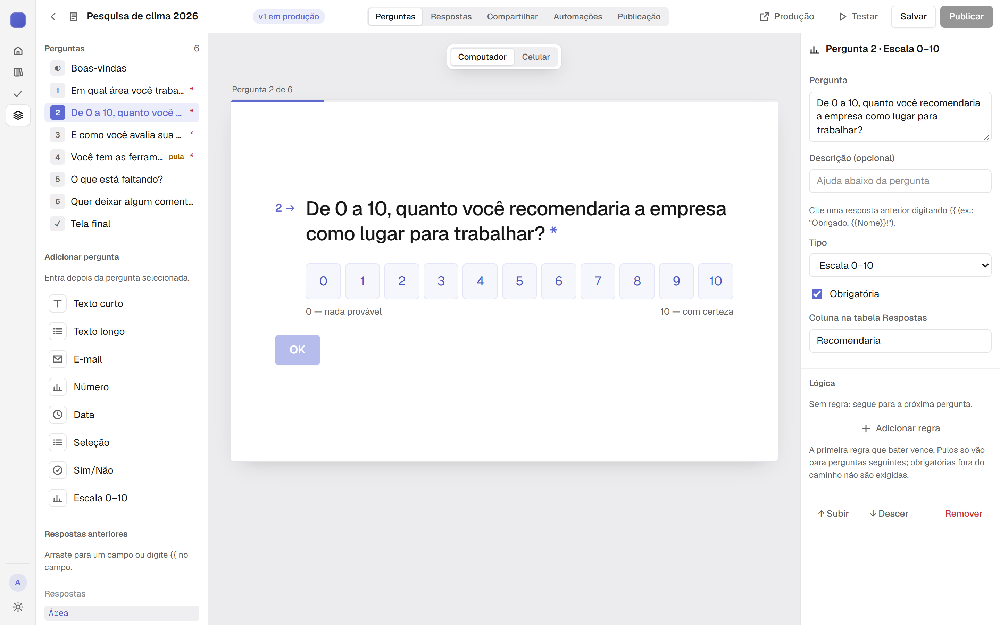

O formulário pode ter link público, sem login, com limite de envios por hora. Cada resposta vira um registro numa tabela comum, então versões, exportação e automações funcionam igual aos mini apps.

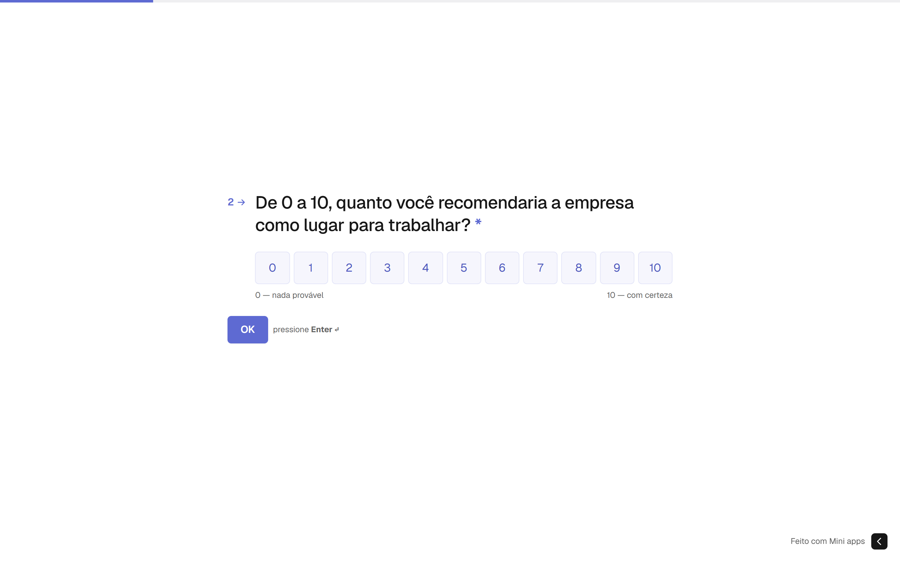

A aba Respostas mostra quantos abriram, quantos enviaram e em que pergunta as pessoas desistem.

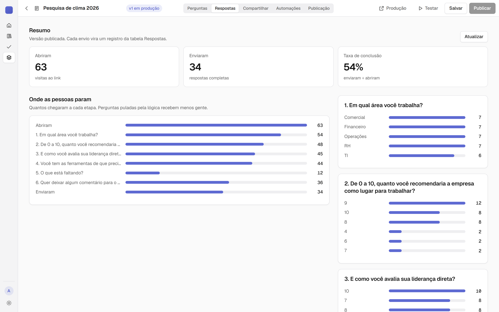

## Workflows

Para o que roda em segundo plano. O workflow começa por um botão, por horário (cron), por webhook ou chamado por outro projeto, e tem passos aninhados: se/senão, para cada, esperar, transformar dados, chamar API, mandar e-mail. As variáveis são tipadas e aparecem para arrastar enquanto você monta.

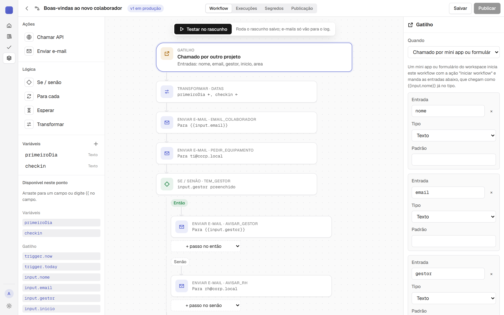

Cada disparo entra numa fila e vira uma execução com o histórico de cada passo, em cascata, com entrada e saída. Os passos podem ter novas tentativas e tempo limite. Segredos (chaves de API) ficam cifrados no workspace e aparecem mascarados no histórico.

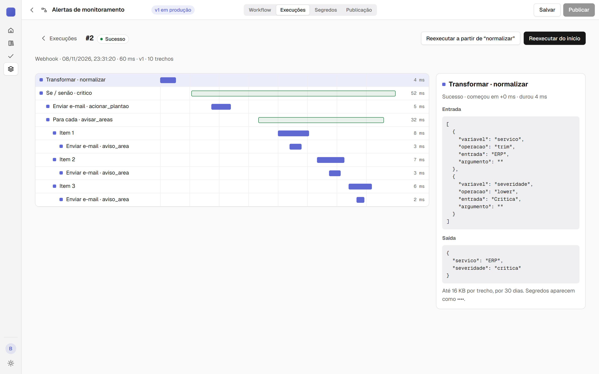

Quando falha, você vê onde, corrige e reexecuta a partir do passo que deu erro, sem repetir o que já tinha funcionado. Em produção, quem criou o workflow recebe um e-mail.

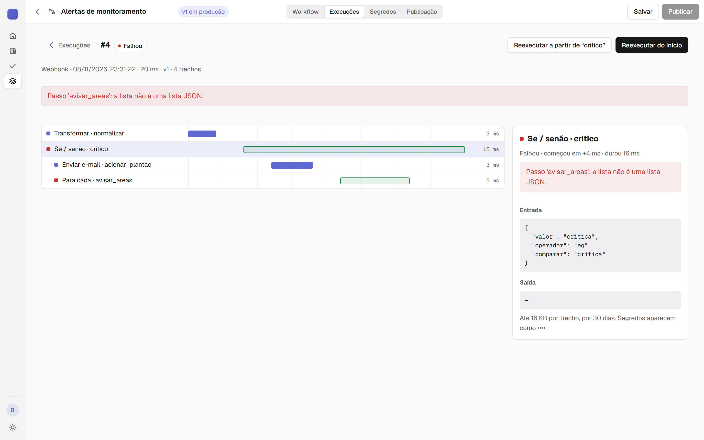

## Projetos que conversam

Os três tipos se chamam. No cenário de demonstração:

- Uma contratação cadastrada no **Onboarding** inicia o workflow de **Boas-vindas**, que manda e-mail para o colaborador, pede o notebook para a TI e avisa o gestor (ou o RH, se ninguém foi indicado).
- Uma despesa aprovada no **Reembolso** inicia o workflow de **Pagamento**, que agenda a data, avisa a controladoria quando passa de R$ 1.000 e confirma com o colaborador.
- Um alerta do sistema de monitoramento chega por webhook em **Alertas de monitoramento**, que aciona o plantão e avisa cada área afetada.

Um formulário também pode mandar a pessoa para outro projeto no fim, com os campos já preenchidos.

## Aprovações

O caso mais comum de todos. O pedido entra, vai para o aprovador, ele aprova ou rejeita com um comentário e o status volta para o registro. Quem pediu recebe e-mail. A decisão pode disparar a próxima automação, como o pagamento do reembolso.

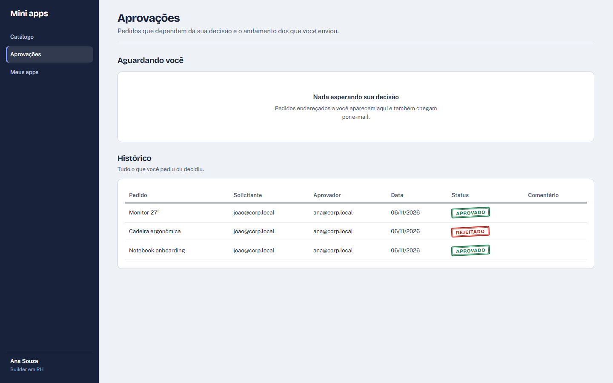

## Biblioteca, versões e governança

A Biblioteca tem os templates e os apps publicados liberados para o seu departamento. Qualquer app pode virar template para as outras áreas, e um app de outra área pode ser clonado para o seu espaço.

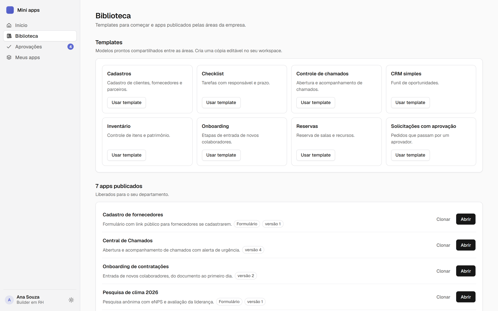

Cada publicação vira uma versão numerada. Se a nova deu problema, restaure a anterior. Renomeou um campo? Os dados acompanham.

Quem administra cria um workspace por área e acompanha a auditoria: quem criou, editou, publicou, abriu, exportou ou aprovou o quê, e quando.

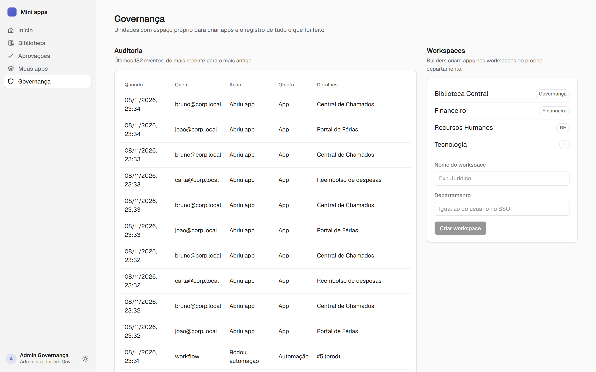

Três perfis: **administrador** (tudo), **builder** (monta apps da própria área) e **usuário** (usa o que foi liberado para o departamento dele e aprova o que for endereçado a ele).

## No celular e no escuro

O app publicado funciona no celular sem configuração, e o editor tem prévia de celular. O tema escuro segue o sistema ou pode ser escolhido no botão de tema, no canto da barra lateral.

<p>
  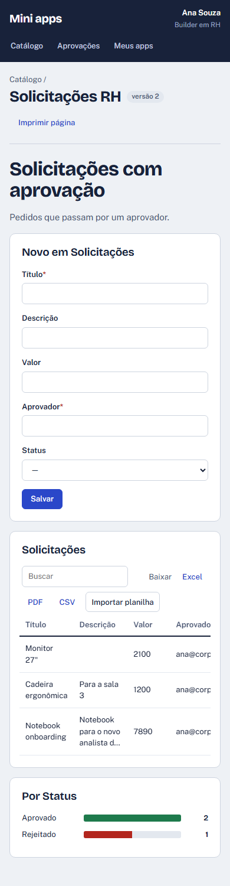
  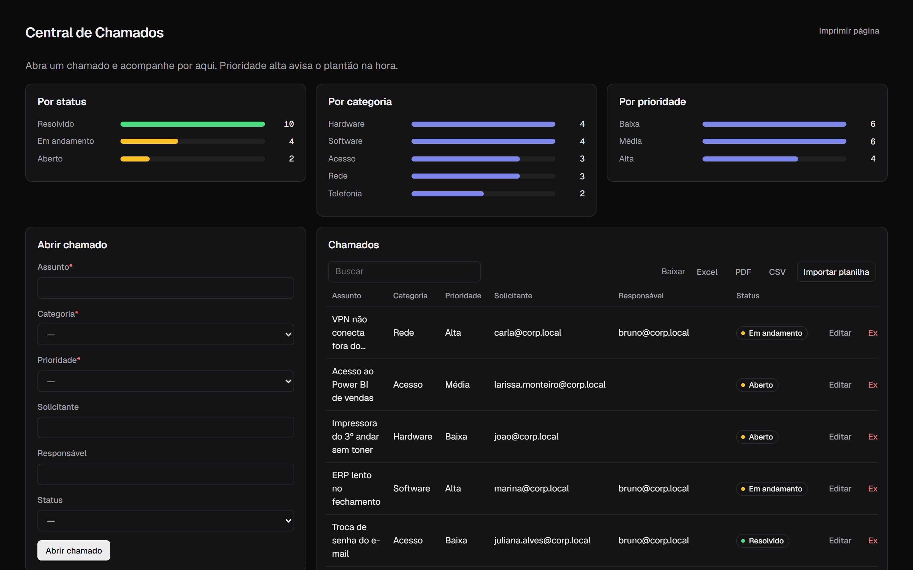
</p>

## O que ainda não faz

Para não ter surpresa:

- Login e e-mail são simulados. O usuário vem de um arquivo de configuração e os e-mails aparecem no log do servidor. A troca pelo SSO e pelo serviço de e-mail da empresa está descrita em [DOCS/TROCA-DE-ADAPTADORES.md](DOCS/TROCA-DE-ADAPTADORES.md).
- Não avisa no Teams nem no Slack.
- Não tem conector pronto para Google Sheets ou SharePoint. Dá para integrar por chamada de API e por webhook.
- Esconder um componente da tela não protege o dado. Para isso existem as permissões de tabela e de campo, que o servidor aplica.

## Rodando o projeto

Angular 20 no front, .NET 10 no back, SQLite como banco.

```bash
cd api/src/Api && dotnet run          # API em http://localhost:5072
cd web && npm install && npm start    # app em http://localhost:4200
```

Na primeira subida a API cria o banco com o cenário de demonstração e já roda as execuções de workflow da fila. Para voltar ao estado inicial, pare a API e apague `api/src/Api/data/`.

Quem está logado é definido em [mock-auth.json](mock-auth.json): troque o `currentUser` e recarregue a página. Todos são `@corp.local`:

| Usuário | Perfil | Bom para mostrar |
|---|---|---|
| `admin` | Administrador | Governança e auditoria |
| `ana` | Builder do RH | Férias, Onboarding, Pesquisa de clima, Boas-vindas, 4 aprovações pendentes |
| `bruno` | Builder da TI | Chamados, Inventário, Acessos, Alertas (com a execução que falhou) |
| `marina` | Builder do Financeiro | Reembolso, Pagamento, Fornecedores, despesas para aprovar |
| `joao` | Usuário do RH | O app do ponto de vista de quem só usa |
| `carla` | Usuária do Financeiro | Lançar despesa e acompanhar o reembolso |

```bash
cd api && dotnet test    # testes do back
cd web && npm test       # testes do front (ChromeHeadless)
```

Mais detalhes: [PRD](DOCS/PRD.md), [formulários](DOCS/PRD-FORMS.md), [workflows](DOCS/PRD-WORKFLOWS.md), [arquitetura](DOCS/ARQUITETURA.md), [referência técnica: banco, rotas e volume](DOCS/REFERENCIA-TECNICA.md), [dependências](DOCS/DEPENDENCIAS.md), [troca de adaptadores](DOCS/TROCA-DE-ADAPTADORES.md), [testes](DOCS/TDD.md) e [decisões (ADRs)](DOCS/ADR/README.md).
